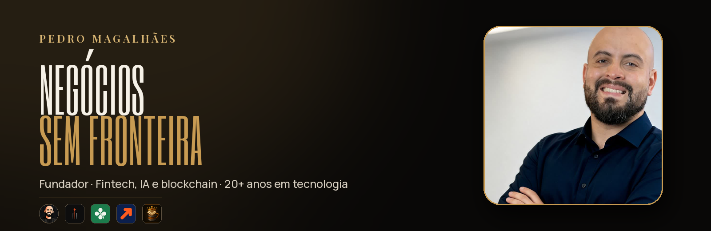
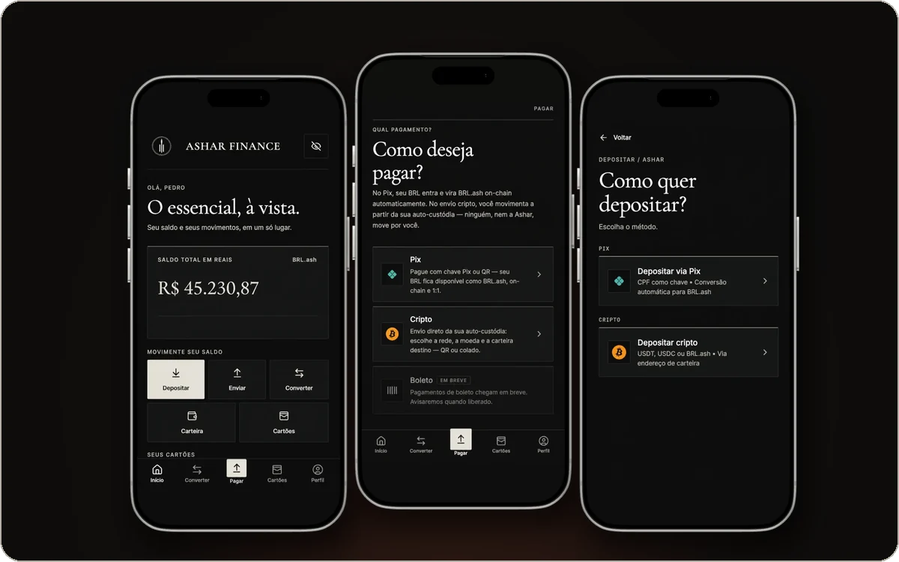
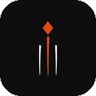
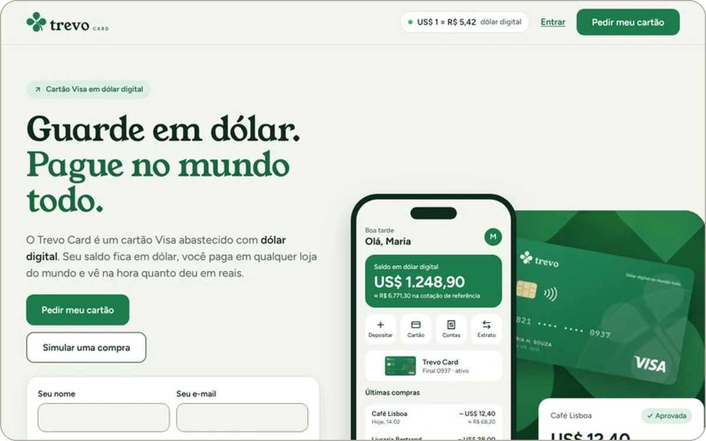
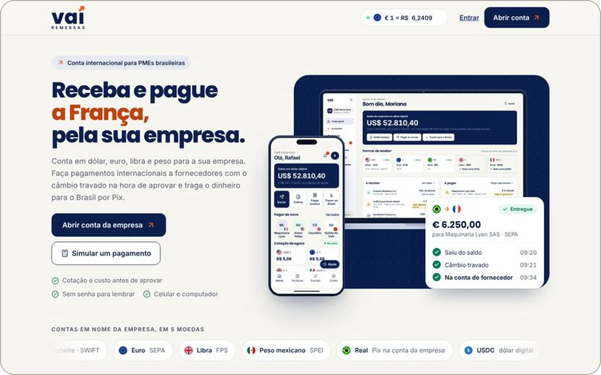
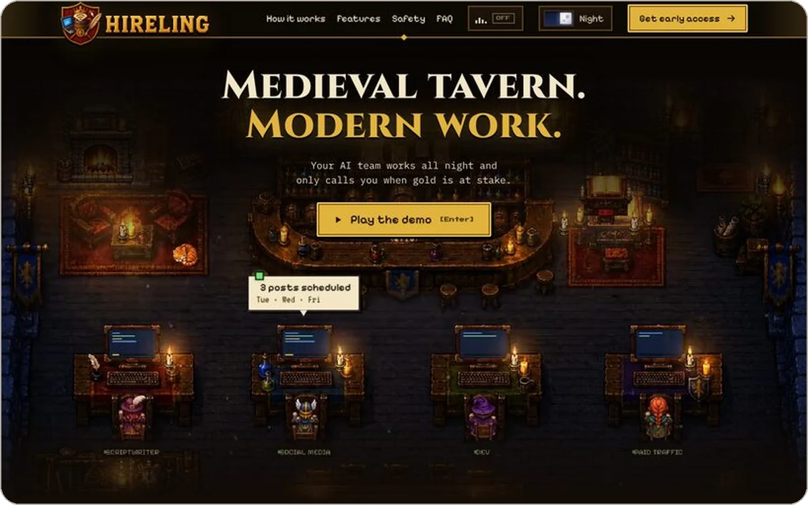

  
  
  
  
  

  Construo produtos financeiros e times de agentes de IA, a partir da América Latina. 
  Mostro como empresas brasileiras recebem, pagam e crescem fora do país — e os bastidores de construir fintech com IA.

 

## Onde estou construindo

<table>
  <tr>
    <td width="50%" valign="top">
      
      <h3>&nbsp; <a href="https://pedrodapps.com">Pedro dApps</a></h3>
      <b>FUNDADOR</b>
      
Canal, blog e newsletter da série <b>Negócios sem fronteira</b>: receber do exterior, pagar fornecedores lá fora, morar e empreender fora do Brasil — com IA no dia a dia.

      
    </td>
    <td width="50%" valign="top">
      
      <h3>&nbsp; <a href="https://ashar.finance">Ashar Finance</a></h3>
      <b>CO-FOUNDER</b>
      
Software house de produtos financeiros: apps de fintech, integrações com exchanges e PSAVs, Pix, cartões e stablecoins — com a marca do cliente. A Ashar faz o software; os serviços regulados ficam com instituições autorizadas.

      
    </td>
  </tr>
</table>

## Produtos no ecossistema

<table>
  <tr>
    <td width="33%" valign="top">
      
      <h4>&nbsp; <a href="https://trevocard.com">Trevo Card</a></h4>
      
Cartão Visa em dólar digital: o saldo fica em USD e cada compra aparece em reais na hora.

    </td>
    <td width="33%" valign="top">
      
      <h4>&nbsp; <a href="https://vairemessas.com">Vai Remessas</a></h4>
      
Conta internacional para PMEs brasileiras receberem e pagarem o mundo, com o dinheiro voltando por Pix. Sou parceiro de tecnologia.

    </td>
    <td width="33%" valign="top">
      
      <h4>&nbsp; <a href="https://playhireling.com">Hireling</a></h4>
      
Time de agentes de IA que trabalha 24/7 nos seus servidores — cada um com papel, orçamento e tela própria. <a href="https://github.com/Play-Hireling/hireling">Open source</a>.

    </td>
  </tr>
</table>

## Últimos vídeos no YouTube

<table>
  <tr>
    <td width="50%" valign="top">
      
      <b>FUJA DO BRASIL: o porquê de eu ter saído</b>
    </td>
    <td width="50%" valign="top">
      
      <b>Curso de PIX do Brasil — Aula 1: integre o PIX direto ou crie a sua própria solução</b>
    </td>
  </tr>
  <tr>
    <td width="50%" valign="top">
      
      <b>Basis Trade: o lucro “sem direção” que as mesas amam</b>
    </td>
    <td width="50%" valign="top">
      
      <b>21 bancos contra a Tether: stablecoin em dólar dos grandes bancos para 2027</b>
    </td>
  </tr>
</table>

  

## Com o que eu trabalho

| | |
|---|---|
| **Fintech** | Pix, cartões, stablecoins, contas multimoeda, conciliação e integrações com instituições autorizadas |
| **IA** | Agentes autônomos, MCP, automação de conteúdo e de operação |
| **Blockchain** | Solidity, EVM, tokenização, Drex / Hyperledger Besu |
| **Plataforma** | Go, TypeScript, Node, React / React Native, Docker, Cloudflare, Postgres |

  

---

   
  📫 <a href="mailto:p@pedrodapps.com">p@pedrodapps.com</a> · Montevidéu, Uruguai 🇺🇾

